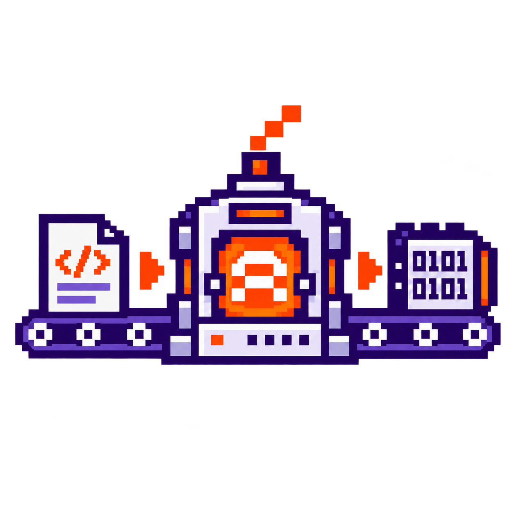

<p align="center"></p>

# Arkade Compiler

[](https://github.com/arkade-os/compiler/actions/workflows/build.yml)
[](https://github.com/arkade-os/compiler/actions/workflows/release.yml)
[](https://github.com/arkade-os/compiler/releases/latest)
[](https://crates.io/crates/arkade-compiler)
[](LICENSE)

Arkade Language is a contract language for Bitcoin. You write a contract as a set of spend functions over constructor state.

The compiler, `arkadec`, turns a contract into a JSON artifact. Arkade libraries consume the artifact directly.

The language covers signature and multisig checks, absolute and relative timelocks, transaction introspection, Arkade Assets and asset groups, byte-string parsing, fixed-size arrays, structs, and contract instantiation with `new` for recursive VTXOs.

## Spending paths

Each spending path is enforced in one of two ways:

- **Operator-enforced:** the operator runs the path's Arkade Script before it cosigns.
- **Bitcoin-enforced:** the path uses only Bitcoin Script, so Bitcoin can enforce it alone, as with every party's unilateral exit.

The two kinds of function map onto them, and the artifact carries both kinds of script:

| Function | Compiles to | Defines |
|---|---|---|
| Arkade Script function: a `function` without a modifier | Arkade Script | An operator-enforced path |
| Tapscript function: a `function` marked `tapscript` | An L1 tapscript leaf | A Bitcoin-enforced path, unless it is bound to an Arkade Script function |

```solidity
contract SingleSig(pubkey user) {
  function spend(signature userSig) {
    require(checkSig(userSig, user));
  }

  function unilateral(signature userSig) tapscript {
    require(older(operatorExitDelay));
    require(checkSig(userSig, user));
  }
}
```

[A tour by example](docs/tour.md) explains this contract and builds on it.

## Quick start

Try it without installing anything in the **[browser playground](https://arkade-os.github.io/compiler)**.

To compile locally, install `arkadec` and run it on a contract:

```bash
cargo install arkade-compiler --locked
arkadec contract.ark                     # writes contract.json
```

[Command line](docs/cli.md) covers prebuilt binaries and every option. From JavaScript or TypeScript, use the [`@arkade-os/compiler`](npm/README.md) package.

## Documentation

### Guides

| Page | Covers |
|---|---|
| [Tour by example](docs/tour.md) | Short contracts for each feature, and the `examples/` directory |
| [Playground](docs/playground.md) | The browser editor, its output tabs, and running it locally |
| [Command line](docs/cli.md) | Installing, `arkadec` options, and the script report |
| [APIs](docs/api.md) | The npm package, the Rust API, and the WASM bindings |
| [Artifact format](docs/artifact.md) | Artifact fields, `codeHash`, the debug file, and the Arkade Script stack ABI |
| [Lints](docs/lints.md) | Every lint, lint attributes, and CLI levels |

### Language reference

| Page | Covers |
|---|---|
| [Syntax, literals and constants](docs/language/syntax.md) | File layout, lexical rules, the version pragma, byte literals, constants |
| [Imports and libraries](docs/language/modules.md) | Import scope and loading, libraries |
| [Types](docs/language/types.md) | Scalar and native types, structs, arrays, casts |
| [Functions and statements](docs/language/functions.md) | Spend groups, helpers, statements, initialization |
| [Expressions](docs/language/expressions.md) | Operators, precedence, and when evaluation fails |
| [Built-ins](docs/language/builtins.md) | Signatures, hashes, time, introspection, assets, bytes, curves |
| [Tapscript functions](docs/language/tapscript.md) | Leaf shape, keys, and binding leaves to Arkade Script functions |

### Contributing

[Development](docs/development.md) covers tests, end-to-end and fuzz testing, and releasing.

## Security

See [SECURITY.md](SECURITY.md) for the disclosure process.
